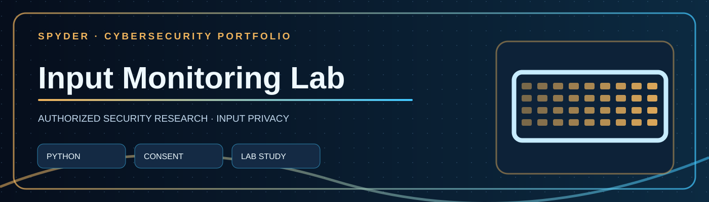

# Input Monitoring Lab — Authorized Security Research

Research prototype demonstrating local keyboard-event capture with Python in an **explicitly authorized laboratory environment**.

## Purpose

- Understand keyboard event handling and input monitoring mechanisms.
- Study risks of collecting unprotected input data.
- Document safe demonstration practices and privacy requirements.

## Safety and privacy

**Use only on systems that you own or administer with explicit informed permission from all affected users.** Do not use for covert surveillance, unauthorized credential collection, or recording private communications.

Keystroke logs may contain passwords or other sensitive information. Never commit captured data to a public repository. Earlier commits may have included sample log files; those files have been removed from the current repository tree as a precaution, but previous revisions remain in Git history.

## Repository contents

- `keylogger.py`: prototype Python source.
- `requirements.txt`: dependencies.
- `Docs/`: supporting educational material.
- `Scripts/`: environment setup helper.

## Validation

No claim is made that the prototype offers secure/encrypted storage, stealth capabilities, or verified cross-platform behavior. Source execution has **not** been validated in this portfolio audit. Avoid running outside an isolated consent-based test environment.

## Maintainer

Abhinav Saini · GitHub: spyderabhi

## License

See `LICENSE`.
